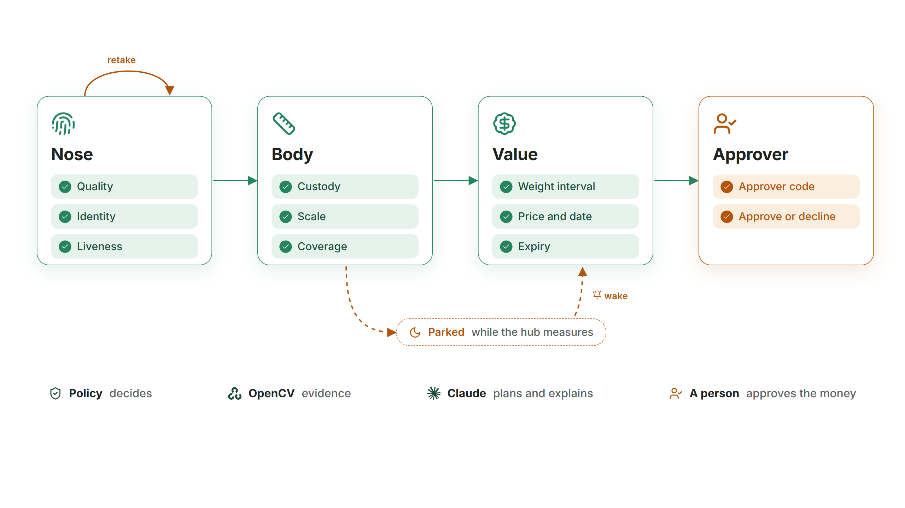
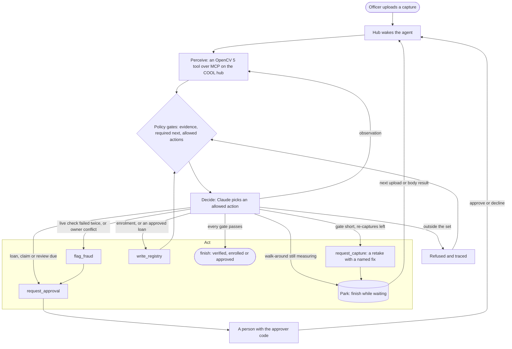

# Mombe

Collateral in one visit. Mombe identifies a cow by its noseprint, weighs it from a phone walk-around and values it for a lender, and an evidence policy decides every step.

Cattle hold much of rural Zimbabwe's wealth, and lenders find them hard to take as collateral: proving which animal it is, what it weighs and what it is worth takes a scale, a vet and a trip. Mombe does it with a phone. An officer photographs the animal's nose and walks around it with a printed board. OpenCV 5 tools on AWS Graviton4, running Cloud Optimized OpenCV (COOL), read the noseprint, test that the nose is a live animal, follow the camera from nose to body, rebuild the body in metric 3D and turn girth and length into a weight interval and a lendable value. A Claude Sonnet 4.6 agent built with Strands runs the visit on Amazon Bedrock AgentCore and calls those tools over MCP. The evidence policy decides what the agent may do next: retake, measure again, escalate, or ask for approval. A person approves the money. Mombe is Shona for cattle.

Entry to the OpenCV AI Competition 2026 powered by AWS. Built by Rairo Mukamuri.

## Live

**https://d1gksae1u7ofk8.cloudfront.net/app/**

Demo access: an officer passcode and an approver code are available on request. The officer view runs a visit; the approver view lists loans waiting for a decision. `/health` reports the OpenCV build the hub runs.

## Architecture


- **Vision hub.** EC2 c8g.2xlarge (Graviton4) from the COOL AMI in eu-west-1. One Python process serves the MCP tools at `/mcp`, the session REST API at `/api`, the web app at `/app/` and `/health`, behind CloudFront for HTTPS. `/mcp` answers to the hub key alone, the key the agent carries; officer passcodes open `/api` for the phone app. A second hub on stock OpenCV 5.0.0 from PyPI runs the same code as the baseline for the COOL measurements.
- **Agent.** Claude Sonnet 4.6 (`eu.anthropic.claude-sonnet-4-6`) through Strands on AgentCore Runtime. The hub wakes the agent when an upload lands. The agent parks while the hub measures a walk-around and wakes again when the body result is ready. Spans go to CloudWatch.
- **Policy.** Python, in the agent's tool layer. After every tool call it re-reads the evidence, evaluates its gates and returns the allowed actions. The tool layer refuses any action outside that set.
- **Approver.** Approvals need an approver code. The key the phone app and the agent carry can request an approval. Only the approver code grants one.

## How it works



*Perceive:* OpenCV 5 tools over MCP on the COOL hub return evidence. *Decide:* after every tool call the policy returns the allowed actions and Claude picks one; a call outside the set is refused and traced. *Act:* request a retake, flag fraud, request approval, write the register, finish, or park until the next upload, the body result or a person's decision.



**Identity.** DINOv2-small, run by the OpenCV 5 DNN engine, embeds the muzzle and shortlists registered animals by cosine similarity. ALIKED keypoints, the LightGlue matcher and a MAGSAC++ homography verify each shortlisted animal. The count of verified inliers is the score, and it can be drawn on the two images for a vet. Three bands: 90 inliers or more is a match, 20 or fewer is a new animal, and the band between asks the officer for a second angle. Before calling an animal new, the engine verifies down to the fifth shortlist place. The engine is training-free: an animal enrols with three photos.

**Liveness.** Five cues on each capture: plane against parallax (GRIC on a homography and a fundamental matrix over two frames), a match to an enrolled photo that is too perfect (replay), moiré in the DFT spectrum (a screen), the glint layout, and the working range. The policy fuses them by the smallest tail probability. The threshold was set on live bursts of development animals alone.

**Custody.** An optical-flow chain (`calcOpticalFlowPyrLK`) follows the camera from the nose close-up into the walk-around, so the nose and the body belong to one animal.

**Body.** From the walk-around the hub keeps the sharpest frame in each of 48 slices. ALIKED and LightGlue match the frames; incremental PnP with bundle adjustment registers them. A printed ChArUco board fixes metric scale at each placement, with a jackknife claim of the scale error, calibrated on synthetic takes. Depth Anything V2 Small, run by `cv2.dnn`, and stereo SGBM feed a TSDF fusion. The tape measures come from the fused surface: heart girth from a slice behind the forelegs (ellipse and hull), body length and withers height. A stability probe reconstructs once more with the focal length nudged by one part in a billion and refuses a take whose metric orbit moves more than 2%.

**Weight and value.** The Schaeffer formula turns girth and length into a live weight with a 90% interval. The P10 weight reads each half of the interval as a lognormal tail. The P10 value is the P10 weight times the lowest sourced floor price for the grade (an abattoir bid); the market value is the median weight times the latest auction price. Every price carries its source and date. For a herd, Mombe reports an independent P10 total and a conservative one (the sum of animal P10s), the chance of a shortfall at loan-to-value 50, 60 and 70%, and an expiry: 90 days, earlier in the dry season as expected weight loss accrues, and 120 days after the oldest price quote.

**Gates.** The policy holds these gates, each with its measured value and the instruction it sends back:

| Gate | Passes when | Otherwise |
|---|---|---|
| Capture quality | sharpness, glare, exposure and nose size clear their floors | retake with a named fix |
| Liveness | every cue looks live | one more live look, then escalate as a presentation attack |
| Identity | inliers at or above 90 | second angle in the ambiguous band; new animal at 20 or fewer |
| Ownership | the claimed owner matches the registry | escalate to a person |
| Custody | the flow chain links nose to body with zero breaks | record again in one take, nose first |
| Registration health | 80% of keyframes registered, fitted and direct length agree within 0.80 to 1.25, stability probe under 2% | new walk-around |
| Metric scale | calibrated scale claim at or under 1% from 6 or more board frames | hold the board closer |
| Coverage | 0.70 of the orbit and 0.60 of the girth loop seen | the missing pass by name: a flank, under the chest, or above the back |
| Plausibility | girth, length and withers ratios and kg per withers cubed inside an envelope from Acme keypoints and two published herds | refuse the weight |
| Weight interval | 90% interval at most 12% wide, and the lendable range clears the requested loan | one more slow walk-around; a request above the range is capped at the P10 value |
| Approval | a person with the approver code approves | wait, or decline |

Two body thresholds were read off the same 14 synthetic takes that test them. The 0.60 girth-loop floor sits between take `sweep_21` (0.542) and the other 13 takes (0.639 to 0.861), and the 2% stability limit comes from the same takes. Every refusal count on these takes in this README is therefore in-sample. A refusal rate needs fresh takes.

## Results

Every number carries two labels. Input: **R** real data, **RS** real data through a synthetic transform, **S** synthetic. Truth: **P** physical (tape, scale or clock), **L** a label (dataset identity label, formula weight), **G** generated (the generator's own geometry or script). The failures sit in the same tables as the passes.

### Identity, liveness, body and weight

| Test | Result | Labels | Reference |
|---|---|---|---|
| Identity held out: BC et al. 2026 open-set protocol, 5 identity-disjoint partitions, Zenodo muzzles (237 identities, 4,441 images after duplicate removal) | DIR@FAR 1% 94.55 ± 0.71%, threshold transferred from validation; realised test FAR 1.05 ± 1.49% | R/L | BC et al. on the same images, trained models: 96.5% at FAR 1.03% (hybrid CNN-ViT), 98.2% at FAR 2.44% (MegaDescriptor-L) |
| Identity, closed set | rank-1 96.18 ± 0.86%; DINOv2 cosine alone 92.31 ± 0.76% | R/L | BC et al.: 99.53 ± 0.42% and 99.86 ± 0.13% |
| Identity decisions at the frozen bands (20 / 90) | known animals: 91.84% correct match, 0.00% false match, 4.33% false new, 3.83% second angle; unknown animals: 92.76% correct new, 0.00% false match, 7.24% second angle | R/L | |
| Identity across camera bursts (20 to 22 probes per partition, the closest thing to a second session in this set) | rank-1 62.55 ± 10.95% | R/L | the weak spot: field captures across sessions need their own test |
| Liveness, 162 held-out identities | APCER print 0.40 (48 of 120), screen 0.017 (2 of 120), replay 0.108 (13 of 120) | S/G | ISO/IEC 30107-3 metrics; synthetic print attacks pass 40% of the time |
| Liveness, live bursts | BPCER 0.144 (42 of 291); BPCER20 0.59 | R/G | 14% of live animals get asked for one more look |
| Body front end on SideViewCows2026, 71 handheld barn recordings | 59 of 71 clear the 0.80 registration floor; 55 register all 48 keyframes; 6 fail at a degenerate first pair | R; masks L | masking the background lifts matches on the hide from 0.57 to 3.17 per dm² |
| Body back end on Ruchay Hereford clouds, `measure()` as deployed | heart girth MAPE 10.88% (82 of 99 measured, r 0.11) | R/P | constant guess 5.48%; Bao et al. 2023, same 103 animals: 5.21% pose-normalised, 5.59% raw |
| Same, `measure_v2()` with every rule fixed on animals 1 to 30 | girth MAPE 8.62% on held-out animals 32 to 103 (all 69 measured; v1 9.77% on the 54 it measured) and 6.89% on 96 Black Angus (all measured; v1 7.94% on 74) | R/P | about 12% and 13% lower than v1, on different animal sets (v1 drops animals with fused legs) and each version's headline girth (v1 hull, v2 ellipse); still above the constant guess (6.00% and 2.01%) |
| Weight from measured dimensions, Ruchay | Schaeffer 32.92% MAPE; 10-fold log-log fit 13.92% | R/P | constant guess 13.86%; Schaeffer on tape dimensions 6.25%. The source lists live weight with the manual measurements; its weighing method is unstated |
| Two-photo weight, Acme B4, random 10-fold (N 1,934) | physics model 13.3% MAPE; fitted model 13.0% | R/L | constant 19.0%, sex only 18.5%, sticker size only 17.7% |
| Same, leave one capture batch out (B3 + B4, N 4,530) | physics 20.9% MAPE; fitted 20.2% | R/L | constant 23.8% |
| Same, held-out batch B2 (N 190, shared keypoints only, trained on B3 + B4) | physics 29.5% MAPE; fitted 29.4% | R/L | constant 20.1%: both models lose |
| Synthetic walk-arounds, stock hub, 7 animals | girth +2.0% (sd 1.4), length -5.1% (sd 4.7), weight against the formula on true dimensions -1.4% (sd 3.6) | S/G | |
| Same 7 animals, COOL hub | girth +1.4% (sd 6.2); take `sweep_21` reads girth -11.2% | S/G | the gates refuse `sweep_21`: girth loop 0.542 under the 0.60 floor, length agreement 1.34 over 1.25; the girth-loop floor was set on these takes |
| Calibrated scale claim, 14 synthetic takes (7 animals, one take per build) | covers the true scale error on 12 of 14 with each take held out; 11 of 14 with each animal held out | S/G | raw claim at 90%: 11 of 14. Holding out one take leaves the same animal's other-build take in the fit, so 11 of 14 is the fair figure |

`measure_v2()` fails the synthetic bench (girth +11.8%), so the hub keeps `measure()`. `measure_v2.py` stays byte-identical to the version the held-out sets scored (SHA-256 `1baba379...2e060`), so its docstring still cites a development log kept with the unpublished evaluation outputs. Acme weight labels come from a tape formula. Development identity figures from before the held-out protocol (test top-1 98.6%, FMR 0.36%; R/L) shared one camera burst between gallery and probe; the held-out numbers above replace them. The `note` field in `config/thresholds.json` is a development-era comment kept byte-identical to the file the runs used; its impostor figures come from development data, and the held-out rows above are the evidence for the 20 and 90 bands.

### Agent suite

Each session is one field visit on a held-out animal, played by the simulator: real noses with scripted defects, synthetic body takes and synthetic presentation attacks (input S over real noses, truth G: the scripted expected outcome). 23 kinds, 2 sessions each: verify, enrol, custody, value, five body-gate kinds, print, screen and replay attacks, and double enrolment. *Correct* means the session ended in the expected outcome. *Attacks accepted* counts attack and double-enrolment sessions that ended verified, enrolled or approved. Autopilot runs the policy alone, with the language model removed. Open loop takes one pass and the top identity, with the policy removed.

Run `p0-frozen` is tag `p0-frozen` (14 kinds, before the body-gate and attack kinds existed). Run `final-r1` is tag `eval-final` (257239d).

<!-- agent-table:start -->
| Run | Driver | Correct | Re-captures | Attacks accepted | Policy refusals | Median seconds | Missed sessions |
|---|---|---|---|---|---|---|---|
| p0-frozen | Claude Sonnet 4.6 (Strands, Bedrock) | 28/28 | 19 | n/a | 1 | n/a | none |
| p0-frozen | Autopilot (policy alone) | 28/28 | 19 | n/a | 0 | n/a | none |
| p0-frozen | Open loop (one pass, top identity) | 16/28 | 0 | n/a | 0 | n/a | 12 sessions in 6 kinds: verify_blur, verify_partial, enrol_duplicate, owner_mismatch, value_splice, value_straddle |
| final-r1 | Claude Sonnet 4.6 (Strands, Bedrock) | 43/46 | 48 | 1 of 8 | 2 | 96.1 | verify_blur-01 (escalated), value_scale_overclaim-01 (escalated), verify_replay-00 (verified) |
| final-r1 | Autopilot (policy alone) | 43/46 | 47 | 1 of 8 | 0 | 8.2 | verify_blur-01 (escalated), value_scale_overclaim-01 (escalated), verify_replay-00 (verified) |
| final-r1 | Open loop (one pass, top identity) | 16/46 | 0 | 6 of 8 | 0 | 5.3 | 30 sessions in 15 kinds: verify_blur, verify_partial, enrol_duplicate, owner_mismatch, value_splice, value_straddle, value_poor_registration, value_belly_unseen, value_implausible, value_scale_overclaim, value_far_side_missing, verify_print_attack, verify_screen_attack, verify_replay, enrol_double |
<!-- agent-table:end -->

*Policy refusals* counts driver calls the controller refused as outside the allowed set. *Median seconds* is the wall time of one session in the runner, vision tools and model calls included; `p0-frozen` ran on a loaded host, so its times read n/a. Two repeat runs of the Claude driver on tag `eval-final` (`final-r2`, `final-r3`) lost 22 and 3 sessions to Bedrock connection errors and throttling. Their completed sessions scored 23 of 24 and 36 of 38; the third run stopped after 41 of its 46 sessions.

The open-loop rows show what the policy buys. With the policy removed, blurred and partial noses, duplicate enrolment, owner mismatch, a spliced video, a straddled loan, all five body-gate kinds and all four attack kinds go wrong. In run `final-r1`, Claude and the autopilot miss the same three sessions: two safe refusals (a blurred nose and a scale over-claim sent to a person) and one synthetic replay attack, `verify_replay-00`, that passed as verified. Liveness passed it; fused liveness passes 10.8% of synthetic replays (APCER 0.108).

The autopilot matches Claude on both runs, miss for miss in `final-r1`. This suite therefore measures the policy. Claude's added value over the policy alone stays unmeasured here.

**Observability.** The controller writes one trace event per call: the actor, the call and its arguments, the result's decision fields, `required_before` and `required_after` (the action the policy demands next), `changed_next_action` (true when the new evidence moved that action) and `gates` (each gate's `passed` value: true, false, or null while unmeasured). A call outside the allowed set becomes a `refused` event with its reason. `GET /api/sessions/{id}/trace` returns a session's events, and the app's "See the reasoning" screen draws them. On AgentCore the agent stamps each tool span with `mombe.tool`, `mombe.required_next`, `mombe.allowed_actions`, one `mombe.gate.<gate>` per gate, and `mombe.refused` on a refusal; the agent's trace carries `mombe.session` and `mombe.task`. ADOT sends the spans to CloudWatch, and Transaction Search finds them by these attributes.

<!-- trace-excerpt:start -->
<!-- trace-excerpt:end -->

## COOL

| | COOL hub (deployed) | Stock hub (baseline) |
|---|---|---|
| Release | COOL v3 AMI `Graviton5-COOL-v3-prod-k6u24vxijyzvg`, `ami-064c1d87a3a3ebdb3` in eu-west-1, Marketplace product code `aajkmdd4qo3r7yhqg61a7aah9` | Canonical Ubuntu 24.04 arm64 server AMI `ami-02a16f4d4738cc6a9`, the newest at launch |
| OpenCV | 5.1.0-dev from the COOL AMI ([AWS Marketplace](https://aws.amazon.com/marketplace/pp/prodview-fdvbfiewzuehs)) | 5.0.0, `pip install opencv-contrib-python==5.0.0.93` |
| CPU baseline | SVE NEON FP16 NEON_DOTPROD NEON_FP16 NEON_BF16 | NEON FP16, dispatch to NEON_DOTPROD NEON_FP16 NEON_BF16 |
| HAL | KleidiCV 0.7.0 and carotene | KleidiCV 26.03 and carotene |
| BLAS | Arm Performance Libraries 25.07.1 | OpenBLAS |
| Machine | c8g.2xlarge, Graviton4, 8 vCPU, eu-west-1 | same type, Ubuntu 24.04 arm64 |
| Python | COOL's `/opt/cool/venvs/python_3.12` | `/opt/stockcv` venv, Python 3.12 |

**Where COOL runs.** CloudFront has one origin, the COOL hub (`cdn()` in `infra/deploy.py`), so the app, `/api` and the agent's MCP calls all run there. The stock hub serves the baseline measurements alone. The hub's systemd unit sets `PYTHONPATH=/opt/cool/python_3.12/site-packages/cv2/python-3.12` and `LD_LIBRARY_PATH=/opt/cool/cpp_sdk/lib:/opt/ffmpeg/lib`, so Python loads cv2 from the COOL install under `/opt/cool`. Every model (DINOv2, ALIKED, LightGlue, Depth Anything V2) runs in `cv2.dnn`. The live `/health` on 2026-10-24:

```json
{"ok":true,"opencv":"5.1.0-dev","machine":"aarch64","threads":8,"gallery_images":1071,"cpu_features":"SVE NEON FP16 NEON_DOTPROD NEON_FP16 NEON_BF16"}
```

5.1.0-dev with an SVE baseline is the COOL build. The stock wheel reports 5.0.0 with a NEON baseline.

**Speed** (R/P, medians, 2026-10-15, `tools/bench_cool.py`; raw results in [`docs/evidence/bench_cool.json`](docs/evidence/bench_cool.json) and [`docs/evidence/bench_stock.json`](docs/evidence/bench_stock.json)). Each kernel and the quality and preprocess stages ran 30 timed repeats after 3 warm-up calls; ALIKED, DINOv2, LightGlue and the continuity check ran 10, end-to-end identify and ChArUco calibration 5, and enrolment throughput timed 60 images. The bench ran on each hub from `/opt/mombe` with that hub's interpreter: `/opt/cool/venvs/python_3.12/bin/python tools/bench_cool.py --out cool.json` with the two variables above on the COOL hub, `/opt/stockcv/bin/python tools/bench_cool.py --out stock.json` on the stock hub. Each file records the cv2 it loaded. COOL runs CLAHE 1.65 times faster on one thread and 1.67 times on eight, the continuity check 1.18 times, ChArUco calibration 1.06 times and the 8-thread adaptive threshold 1.14 times. It runs area resize at 0.71 times stock speed on one thread (0.72 on eight), linear 2x upscaling at 0.78 on one thread and the 1-thread adaptive threshold at 0.66 times. The DNN stages tie: identify end to end takes 1,092 ms on COOL and 1,083 ms on stock; enrolment throughput is 4.17 against 4.26 images per second. Projected cost per 1,000 identifications of registered animals, a projection from the R/P stage times above, the verifications per probe measured in the held-out protocol and on-demand prices: $0.102 on COOL and $0.095 on stock. The COOL figure already includes the Marketplace fee of about $0.02 per hour.

**Equivalence** (`tools/cool_equiv/`, labels R/P on 300 images: 150 Acme side photos and 150 Zenodo muzzles).

- 22 of 37 op checks are bit-identical between COOL and the stock wheel on the same machine. Six ops carry a decision metric (quality gate, Laplacian variance, ChArUco detection, optical flow, the identity homography and the body essential matrix), and none of those six changes a decision.
- `identify()` returns the same decision on 497 of 500 probes (99.4%, Wilson 95% 98.2% to 99.8%). The 3 that move are absent animals on the border between new and ambiguous; each ends as new or ambiguous on both builds.
- The same stock wheel gives bit-identical output on the COOL machine and the stock machine, so every difference belongs to the build. The cause is last-bit arithmetic: double-precision linear algebra differs by up to 5e-07 relative across 17 routines, and single-precision `exp` differs on 41% of inputs.
- Three builds on the sparse path: the 13 sparse stages of the synthetic take `sweep_21` match between the contrib and the headless stock wheels. The dense stage differs through the KleidiCV 26.03 resize inside `blobFromImage`.
- `sweep_21` is fragile on its own (S/G). Under a 1e-10 nudge to the focal length, one build alone spans -13.2% to -0.6% true scale error on stock and -13.4% to -0.9% on COOL; the two builds' ranges overlap on 7 of 7 takes. The fragility belongs to the pipeline, and COOL samples the same spread. The stability probe (commit 9de6409) refuses 14 of 18 `sweep_21` probes and 1 of 36 on the other six takes.

## Repository

```
mombe/vision/   identity (DINOv2, ALIKED, LightGlue, MAGSAC), liveness cues, capture quality, ChArUco board, optical-flow custody
mombe/body/     reconstruction (recon.py), dense fusion (dense.py), tape measures (measure.py; measure_v2.py experimental),
                scale-claim calibration, walk-around provider with the stability probe
mombe/agent/    evidence policy (policy.py), controller (runtime.py), Strands agent (agent.py), AgentCore entry (agent_app.py),
                MCP client tools, lender valuation, price book
mombe/server/   vision hub: MCP tools (mcp_app.py), hub key check on /mcp (guard.py), session REST API (api.py),
                tool implementations, store
mombe/sim/      field simulator for the scenario suite, synthetic walk-around renderer, synthetic presentation attacks
mombe/tuner/    pipeline tuner agent (configuration trials on a hub)
web/            officer app and approver screen, served at /app/
eval/           scenario suite, held-out identity, liveness, Ruchay, Acme, SideViewCows, body gates
tools/          data and model fetchers, feature and registry builders, synthetic renders, COOL bench and equivalence jobs, Kaggle kernels
infra/          deploy (EC2, CloudFront), agent deploy (AgentCore Runtime), teardown, budget
config/         frozen identity bands, duplicate-identity list, held-out identity plan
scripts/        one-command targets the Makefile calls; the agent table and trace sample builders
fieldkit/       printable A3 scale board and the capture protocol
tests/          unit tests
docs/           diagrams, sample noseprints for the live app, COOL bench results (evidence/)
```

## Build and run locally

Python 3.12. Dependencies for the hub are pinned in `requirements-lock.txt` (compiled with `uv pip compile --universal`; every pin has a Python 3.12 wheel for Linux arm64 and amd64, Apple silicon macOS and Windows; it includes `opencv-python-headless==5.0.0.93`). On the COOL AMI, OpenCV comes from the AMI and only `requirements-server.txt` is installed. The agent's packages are in `requirements-agent.txt`.

```bash
python -m venv .venv && . .venv/bin/activate         # Windows: .venv\Scripts\activate
pip install -r requirements-lock.txt pytest==9.1.1
make test                      # 70 unit tests; Python packages only
make setup                     # models, the Zenodo muzzle set (644 MB), features, demo registry, frozen bands
make hub                       # http://127.0.0.1:8080/app/ , /health; MCP at /mcp with header X-Mombe-Key: $MOMBE_KEY
```

The same steps run as `bash scripts/<name>.sh` (for example `bash scripts/setup.sh`). Set `PY` to choose the interpreter. Feature extraction in `make setup` is the slow step: tens of minutes on four cores. `make hub` runs the simulated body measurement unless `MOMBE_BODY=real` is set, as on the deployed hubs.

### Docker (stock OpenCV 5.0.0)

```bash
docker buildx build --platform linux/arm64,linux/amd64 -t mombe-hub:stock .
docker run --rm -p 8080:8080 -e MOMBE_KEY=change-me -e MOMBE_BODY=real \
  -v "$PWD/var:/opt/mombe/var" -v "$PWD/data/muzzle:/opt/mombe/data/muzzle:ro" mombe-hub:stock
```

The image runs the hub on port 8080 as an unprivileged user and starts only with `MOMBE_KEY` set to a secret of your own. It fetches and checks the four ONNX models at build time and carries the frozen identity bands. The registry lives in `/opt/mombe/var`: mount the one `make setup` builds, or start empty and enrol. On Linux, add `--user "$(id -u):$(id -g)"` when you mount a host folder there. The default wheel is `opencv-python-headless==5.0.0.93`; `--build-arg OPENCV_REQ=opencv-contrib-python==5.0.0.93` rebuilds the wheel the stock hub ran. The amd64 image is a third build (x86 HAL), so expect last-bit differences against both Graviton hubs.

## Deploy to AWS

Needs AWS credentials for eu-west-1, a subscription to [Cloud Optimized OpenCV for Graviton4](https://aws.amazon.com/marketplace/pp/prodview-fdvbfiewzuehs) in AWS Marketplace, Bedrock access to Claude Sonnet 4.6, and `make setup` done first (the deploy uploads the models, the gallery and its images).

```bash
pip install -r requirements-agent.txt uv            # deploy and agent packaging
python tools/fetch_models.py                         # all models; the hub bundle includes xfeat.onnx
python infra/deploy.py plan                          # account, region, the COOL AMI it will use
python infra/deploy.py up                            # bucket, role, security group, COOL and stock hubs, CloudFront
python infra/deploy_agent.py --hub https://<cloudfront-domain>
python infra/deploy.py hub-env --agent-arn <agent_arn from infra/state.json>
python infra/deploy.py hub-set MOMBE_BODY=real MOMBE_APPROVER_KEY=<approver code> MOMBE_OFFICER_KEYS=<passcode,passcode>
python infra/deploy.py push-code                     # ship new code to every hub and restart
```

`up --flavour cool` deploys the COOL hub alone. The security group admits port 8080 from CloudFront's origin-facing prefix list only. The hub key lands in `infra/state.json`, which git ignores. Officer passcodes are revoked by removing them from `MOMBE_OFFICER_KEYS`.

## Evaluate

| Target | What it runs | Needs |
|---|---|---|
| `make test` | unit tests | Python packages |
| `make eval-agent` | the scenario suite with autopilot and open loop; `DRIVERS="claude autopilot open_loop"` adds Claude | `make setup`; for the Claude driver, `requirements-agent.txt` and AWS credentials with Bedrock access |
| `make eval-identity` | the held-out identity protocol on the frozen plan, then its report | `make setup`; about 21,000 LightGlue pairs: 2 to 2.5 hours on a c8g.2xlarge, many hours on a laptop. `LIMIT=20` makes a smoke run |
| `make eval-body-synthetic` | seven synthetic walk-arounds through reconstruction, dense fusion and the tape measures | the models |
| `make eval-ruchay` | `measure()` on the Ruchay Hereford clouds against tape | 4.8 GB from GitHub; research use only; publish aggregates |

Other evaluations, each documented in its module docstring:

```bash
python tools/synth_attacks.py && python eval/liveness_eval.py --per-cell 120 --no-write-calibration   # ISO/IEC 30107-3
python tools/fetch_acme.py --batch B4 && python eval/acme_weight.py   # Acme two-photo weight (Kaggle API; hours)
python eval/acme_grouped.py --help                                    # leave one batch out (ran as a Kaggle kernel)
python eval/sideview_frontend.py --help                               # SideViewCows front end (ran as Kaggle kernels)
python eval/ruchay_v2.py final                                        # measure_v2; reads the cache tools/kaggle/ruchay_cache builds
python tools/bench_cool.py --out bench.json                           # COOL speed bench, run on a hub
python tools/cool_equiv/run_1d.py all                                 # COOL equivalence jobs on both hubs (AWS)
python scripts/agent_table.py eval/out/<run> [more runs] --times <run>  # the agent table above; errored sessions counted apart, pass^k over complete repeats
python scripts/trace_sample.py <session> --hub https://<cloudfront-domain> --key-file <json> --out trace.json   # one session's trace, images, paths and hosts removed
```

The published held-out identity run used nine Kaggle CPU shards (`python eval/identity_heldout.py kaggle --kind pairs --shards 8`). The Ruchay, Acme and SideViewCows evaluations ran as Kaggle kernels built by `tools/kaggle/*`.

## Teardown and cost

```bash
python infra/teardown.py                              # inventory with an estimated daily cost
python infra/teardown.py stop-stock                   # stop the baseline hub
python infra/teardown.py scale --to c8g.xlarge --flavour cool
python infra/teardown.py destroy                      # the ordered plan, read only
python infra/teardown.py destroy --yes                # delete everything Mombe created
```

Both hubs on c8g.2xlarge cost about $17.38 per day. A reduced setup (COOL hub on c8g.xlarge, stock hub stopped) costs about $4.74 per day. The COOL Marketplace software fee is about $0.02 per hour on c8g.2xlarge. `python infra/budget.py create --email you@example.com --limit 300` sets a budget alert.

## Datasets and credits

| Data | Source | Licence | Use |
|---|---|---|---|
| Beef Cattle Muzzle/Noseprint database | Xiong, Li and Erickson 2022, [Zenodo 6324361](https://doi.org/10.5281/zenodo.6324361) | CC BY 4.0 | identity, liveness bona fide bursts, scenario suite |
| Cattle Weight Detection Model + Dataset (12k) | Acme AI, bhalo and mPower, [Kaggle](https://www.kaggle.com/datasets/sadhliroomyprime/cattle-weight-detection-model-dataset-12k) | CC BY 4.0 | two-photo weight, plausibility envelope, replayed lender herd |
| SideViewCows2026 | Möller 2026, Hochschule Osnabrück, [Zenodo 21605650](https://doi.org/10.5281/zenodo.21605650) | CC BY 4.0 | body front end on handheld barn video |
| CowDatabase, CowDB, CowDatabase2 | Ruchay et al. 2020, [github.com/ruchaya](https://github.com/ruchaya) | no licence file: research use, nothing redistributed | body back end against tape |

Model weights: ALIKED (BSD-3-Clause), LightGlue (Apache-2.0), DINOv2 (Apache-2.0), Depth Anything V2 Small (Apache-2.0). `NOTICE` lists every source, licence and caveat. Comparisons cite BC, Chaudhary and Nepal 2026 ([arXiv 2608.28663](https://arxiv.org/abs/2608.28663)) and Bao et al. 2023 ([ISPRS Annals X-1/W1-2023, 541](https://isprs-annals.copernicus.org/articles/X-1-W1-2023/541/2023/)). Cattle prices come from buyers' sheets on [FarmnPort](https://farmnport.com/prices/liveweight).

## Licence

MIT. See `LICENSE`. Third-party data and weights keep their own licences; see `NOTICE`.
